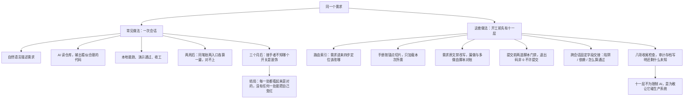

这份页面来自一次真实的工程复盘，已经被作者做过脱敏处理：所有具体的库名、表名、接口、地址都换成了功能性描述，但**机制全部保留**。它把某个工业级多租户业务系统里，所有「给 AI 看的文档」的标题提取出来，按它们各自拦住的事故分成十一层，再把撑起这些细节的两份底稿逐章解剖。

<Callout type="note" title="来源说明">
本文整理自 **Datawhale 社区**，原文以交互长图形式呈现，下方为完整交互版（原作者已做脱敏）。篇幅较长，建议点右上角「新标签打开 ↗」全屏阅读；文内可搜索、可逐层展开。
</Callout>

它的核心结论很反直觉：**所谓「AI 写代码写不好」，多数时候不是模型不行，是没人告诉它这个系统的边界在哪、红线在哪、怎么算做完。** 十一道防线不是为了限制 AI，而是为了敢让它碰生产系统。

两条路的分叉，一张图看清：

页面的结构沿着这条线索展开：

1. **同一个需求，两条路**——一次会话 vs. 开工前先存在的十一层；
2. **规模与口径**——69 份文档、1067 条标题、560 份验证留痕，每个数字都给口径；
3. **十一道防线**——按「拦什么事故」归类，每道讲清触发时机、能干什么、解决什么问题、怎么实现；
4. **三张机制图**——单据生命周期七跳事件链、为什么隔离是两道且顺序不可颠倒、动手前怎么把「不知道」变成能对账的格子；
5. **两份底稿解剖**与收尾。

下面是完整交互版，可直接在页内搜索机制、点开任意一道防线看它的五拍因果链：

<LabEmbed
  src="/static/lab/ai-eleven-defenses.html"
  title="让 AI 写代码背后的十一道防线（交互全文）"
  height={960}
  hint="单文件页面，离线可跑；搜索框支持按「禁手改 / 编号 / 退出码 / 只读 / 未知」等关键词过滤，点卡片顶上的出处可跳到底稿对应章节。"
/>
